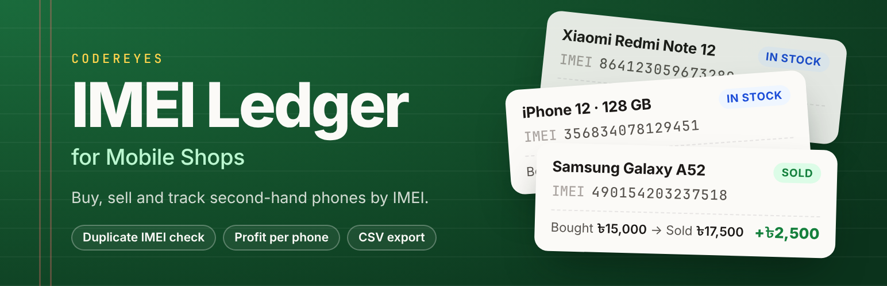
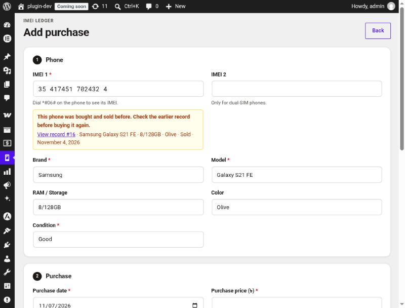
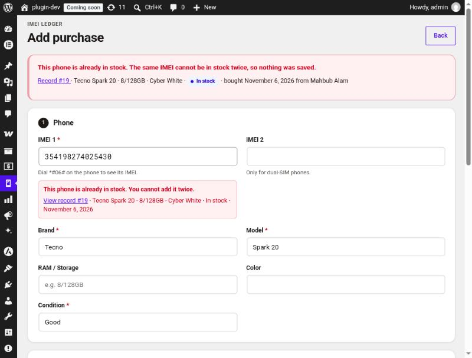
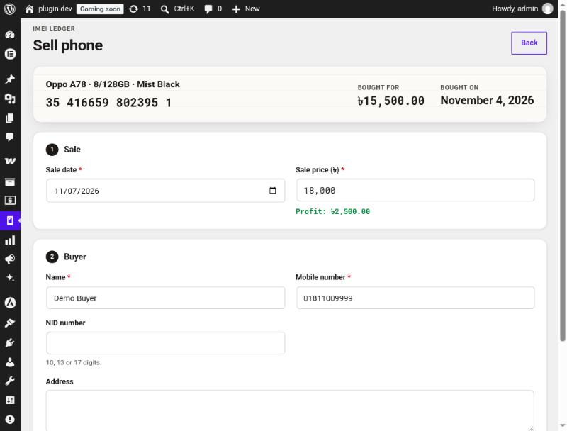
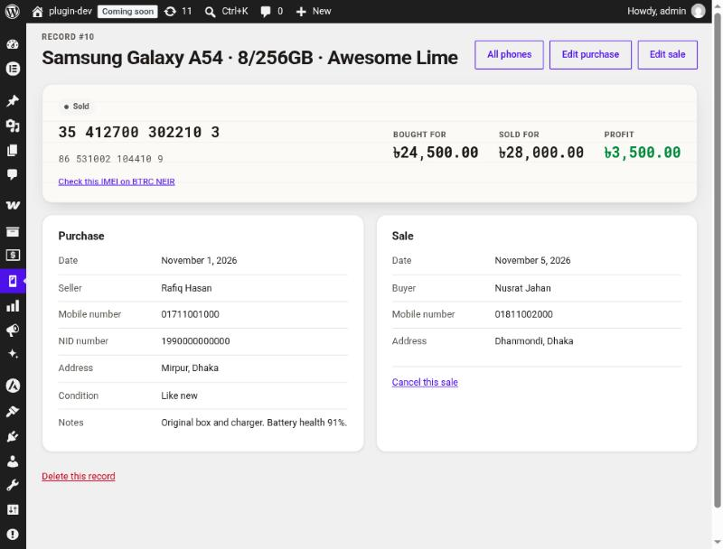
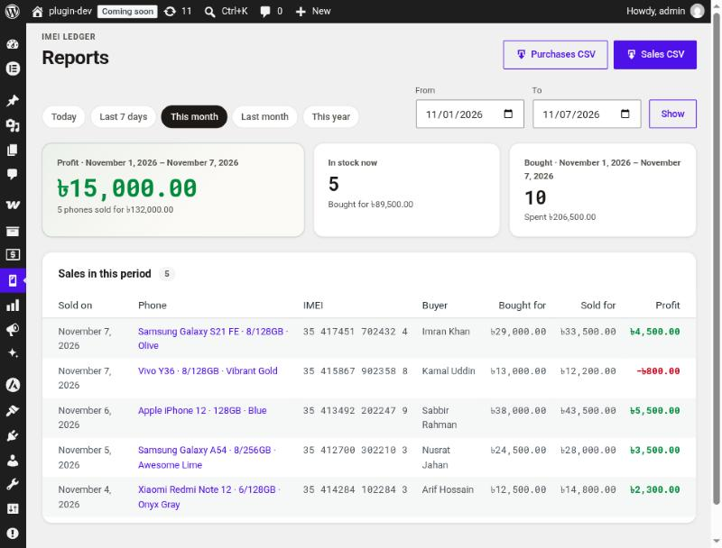

# Codereyes IMEI Ledger for Mobile Shops

[](https://wordpress.org/plugins/codereyes-imei-ledger/)
[](https://wordpress.org/plugins/codereyes-imei-ledger/)
[](https://wordpress.org/plugins/codereyes-imei-ledger/)
[](https://wordpress.org/plugins/codereyes-imei-ledger/advanced/)
[](https://github.com/shahadul878/codereyes-imei-ledger/actions/workflows/deploy.yml)
[](https://www.gnu.org/licenses/gpl-2.0.html)

**A buy and sell ledger for second-hand mobile phone shops. Every phone is tracked by its IMEI: who sold it to you, what you paid, who bought it and what you earned.**

[Install from WordPress.org](https://wordpress.org/plugins/codereyes-imei-ledger/) · [User Guide](docs/USER-GUIDE.md) · [Changelog](readme.txt) · [Report an issue](https://github.com/shahadul878/codereyes-imei-ledger/issues)

---

## Why this plugin

Shops that trade used phones need to answer the same questions every day: *Have we seen this phone before? Who brought it in? Is it still in stock? Did we make money on it?* Paper registers and spreadsheets can't stop the same IMEI being entered twice or catch a mistyped digit. This plugin keeps the register inside WordPress and checks every entry.

## Features

| | |
|---|---|
| **Purchase records** | IMEI 1 and 2, brand, model, storage, colour, condition and price, with the seller's name, mobile number, NID and address. |
| **Sales and profit** | Record the buyer and sale price; a live preview shows profit or loss as you type. |
| **IMEI validation** | The 15-digit Luhn check digit catches typing mistakes while you type. Bengali digits (০–৯) work everywhere. |
| **Duplicate protection** | A phone already in stock can't be added twice. A phone sold before shows the earlier record and needs confirmation before you buy it back. |
| **Fast search** | Find a phone by full or partial IMEI, name, mobile number, NID or model. |
| **Reports** | Stock, sales and profit for any date range, with quick ranges such as today, this month and last month. |
| **Excel-safe CSV export** | Bengali text survives, IMEIs stay as text, and spreadsheet formulas are neutralised. |
| **Undo mistakes** | Cancel a sale entered by mistake and the phone goes back into stock. |
| **NEIR lookup** | One click to check an IMEI on BTRC NEIR. |

No WooCommerce needed. The ledger is a standalone admin tool and adds nothing to the front end of your site.

## Screenshots

| | |
|---|---|
|  |  |
| **All phones:** monthly summary, search and the phone list. | **Add purchase:** the live IMEI check warns that this phone was traded before. |
|  |  |
| **Duplicate blocked:** a phone in stock can't be added twice. | **Sell phone:** profit appears as you type the price. |
|  |  |
| **Record:** one phone's purchase, sale and profit. | **Reports:** any date range, with CSV downloads. |

## Installation

**From your dashboard (recommended):** go to **Plugins → Add New Plugin**, search for **IMEI Ledger**, then install and activate *Codereyes IMEI Ledger for Mobile Shops*.

**With WP-CLI:**

```bash
wp plugin install codereyes-imei-ledger --activate
```

**Manually:** download the zip from [WordPress.org](https://wordpress.org/plugins/codereyes-imei-ledger/) or [GitHub Releases](https://github.com/shahadul878/codereyes-imei-ledger/releases/latest), then upload it under **Plugins → Add New Plugin → Upload Plugin**.

**Requirements:** WordPress 6.4 or later, PHP 7.4 or later, MySQL or MariaDB.

### Quick start

1. Open **IMEI Ledger → Add Purchase** and record a phone. Dial `*#06#` on the phone to see its IMEI.
2. When it sells, open it from **IMEI Ledger → All Phones** and choose **Sell**.
3. Check **IMEI Ledger → Reports** for profit over any period.

The [User Guide](docs/USER-GUIDE.md) covers every screen in plain language for shop owners and staff.

## Data and privacy

- All records, including seller and buyer NID numbers, stay in **your own WordPress database**. Nothing is sent to an outside service.
- Only users with the `manage_imei_ledger` capability can see the ledger. Administrators get it on activation, and so do Shop Managers when WooCommerce is installed.
- Uninstalling **keeps your records** so a mistaken uninstall can't wipe your history. See [Configuration](#configuration) to delete everything.

## Configuration

| Setting | How |
|---|---|
| Currency symbol (default `৳`) | `add_filter( 'imei_ledger_currency_symbol', fn() => 'Tk ' );` |
| Delete all data on uninstall | `define( 'IMEI_LEDGER_DELETE_DATA', true );` in `wp-config.php`, then uninstall |
| Give other roles access | Grant the `manage_imei_ledger` capability with any role editor plugin |

---

## For developers

### Architecture

Business rules live in small pure classes that run without WordPress or a database, so they are fully unit-tested. The repository is the only class that talks to `$wpdb`; admin classes only read requests and render views.

```
codereyes-imei-ledger.php           Bootstrap: constants, requires, hooks
uninstall.php                       Keeps data unless IMEI_LEDGER_DELETE_DATA is true
includes/
  class-imei-ledger-*.php           Pure rules: Digits, Imei, Money, Validator,
                                    Duplicates, Query, Csv, Status
  class-imei-ledger-installer.php   Table (dbDelta) and capability
  class-imei-ledger-repository.php  All $wpdb access
  admin/                            Menu, screens, admin-post handlers, AJAX, list table
views/                              Templates (all output escaped)
assets/                             admin.css, admin.js (no build step)
tests/unit/                         PHPUnit tests for the pure rules
docs/                               User guide, screenshots, brand sources
.github/workflows/                  WordPress.org deploy and asset sync
.wordpress-org/                     Icon, banner and screenshots (SVN assets/)
```

Technical notes:

- WordPress 6.4+ because the code uses `%i` identifiers in `$wpdb->prepare()` and `wp_admin_notice()`.
- Duplicate checks run inside a MySQL `GET_LOCK()`, so two staff saving the same IMEI at once can't both succeed.
- Money is handled in integer cents and accepts lakh-style commas (`1,50,000`).

### Local development

```bash
composer install
```

```bash
composer test
```

Coding standards use the WordPress ruleset (PHPCS with WPCS installed globally):

```bash
phpcs --standard=WordPress --extensions=php --ignore=vendor/*,tests/* .
```

Plugin Check, the same tool the WordPress.org review team uses:

```bash
wp plugin check codereyes-imei-ledger --exclude-directories=tests,vendor,docs --ignore-codes=hidden_files,application_detected,unexpected_markdown_file
```

### Releasing

Releases deploy to WordPress.org automatically from GitHub Actions.

1. Bump the version in `codereyes-imei-ledger.php` (the `Version:` header and `IMEI_LEDGER_VERSION`) and in `readme.txt` (`Stable tag:`), and add a `== Changelog ==` entry.
2. If the table schema changed, also bump `Imei_Ledger_Installer::DB_VERSION` and update the `CREATE TABLE` SQL. `dbDelta` runs automatically when the stored version differs.
3. Commit, tag and push:

   ```bash
   git tag -a v1.0.2 -m "Codereyes IMEI Ledger 1.0.2"
   ```

   ```bash
   git push origin master v1.0.2
   ```

| Workflow | Runs when | What it does |
|---|---|---|
| [`deploy.yml`](.github/workflows/deploy.yml) | A `v*.*.*` tag is pushed, or run by hand with a version | Checks the version matches the plugin header, `IMEI_LEDGER_VERSION`, `Stable tag` and changelog. Runs PHPUnit on PHP 7.4 and 8.3 and Plugin Check on the shipped files. Then commits to SVN `trunk/` and `tags/<version>/`, syncs assets, and (for tags) attaches the zip to a GitHub release. |
| [`update-assets.yml`](.github/workflows/update-assets.yml) | `readme.txt` or `.wordpress-org/` changes on `master` | Updates only the readme, icon, banner and screenshots on WordPress.org, without a release. |

The workflows need two repository secrets: `SVN_USERNAME` and `SVN_PASSWORD`. The password is the SVN password generated under **Edit Profile → Account & Security** on WordPress.org, not your login password.

To build a zip locally, run `wp dist-archive wp-content/plugins/codereyes-imei-ledger`. It honours `.distignore`, so tests, vendor, docs and Markdown files are left out.

### Brand assets

The icon and banner are generated from sources in [`docs/brand/`](docs/brand/). Edit `icon.svg` or `banner.html`, then run `docs/brand/render.sh`. It uses headless Chrome with the Inter, JetBrains Mono and Noto Sans Bengali fonts to rewrite the PNGs and `icon.svg` in `.wordpress-org/`.

### Security

- Every state-changing request checks the `manage_imei_ledger` capability and a nonce (per record for delete and cancel-sale).
- All SQL goes through `$wpdb->prepare()`. Column names and sort order come from whitelists in `Imei_Ledger_Query`.
- CSV cells starting with `= + - @` are prefixed with `'`. Digit columns get a leading tab so spreadsheets keep them as text.
- The list page posts its export filters, so searched names, phones and NIDs don't end up in URLs or server logs.

Found a security problem? Please don't post the details in a public issue. Open an issue asking for a private contact, and we'll follow up.

## Contributing

Bug reports and pull requests are welcome. Please run `composer test` and PHPCS before opening a pull request, and add a unit test for any change to the rules in `includes/`.

## License

[GPL-2.0-or-later](https://www.gnu.org/licenses/gpl-2.0.html). Made by [Codereyes](https://github.com/shahadul878).
