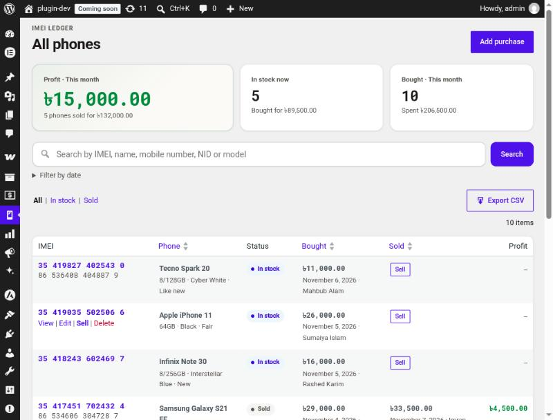

# Codereyes IMEI Ledger for Mobile Shops

A WordPress plugin for second-hand phone shops: a purchase and sale ledger where every phone is tracked by its IMEI.

- Record purchases (IMEI 1/2, phone details, seller with mobile and NID) and sales (buyer, price), with profit per phone.
- IMEI check-digit validation, live while typing. Bengali digits accepted everywhere.
- Duplicate protection: an IMEI already in stock is blocked; one sold before needs explicit confirmation.
- Search by IMEI, name, mobile, NID or model. Reports by date range. Excel-safe CSV export.



**Shop owners and staff:** read the [User Guide](docs/USER-GUIDE.md).
**WordPress.org listing:** see [readme.txt](readme.txt).

---

## Requirements

- WordPress 6.4+ (uses `%i` in `$wpdb->prepare()` and `wp_admin_notice()`)
- PHP 7.4+
- MySQL / MariaDB (uses `GET_LOCK()` to serialise duplicate checks)

## Project layout

```
codereyes-imei-ledger.php           Bootstrap: constants, requires, hooks
uninstall.php                       Keeps data unless IMEI_LEDGER_DELETE_DATA is true
includes/
  class-imei-ledger-*.php           Pure rules (no WordPress needed): Digits, Imei,
                                    Money, Validator, Duplicates, Query, Csv, Status
  class-imei-ledger-installer.php   Table (dbDelta) and capability
  class-imei-ledger-repository.php  All $wpdb access
  admin/                            Menu, screens, admin-post handlers, AJAX, list table
views/                              Templates (all output escaped)
assets/                             admin.css, admin.js (no build step)
tests/unit/                         PHPUnit tests for the pure rules
docs/                               User guide and screenshots
.wordpress-org/                     WordPress.org screenshots (SVN assets/)
```

Business rules live in the pure classes so they can be tested without WordPress or a database. The repository is the only class that talks to `$wpdb`; admin classes only read requests and render views.

## Development

```bash
composer install
```

```bash
composer test
```

Coding standards (WordPress ruleset; PHPCS with WPCS installed globally):

```bash
phpcs --standard=WordPress --extensions=php --ignore=vendor/*,tests/* .
```

## Releasing

1. **Bump the version** in three places:
   - `codereyes-imei-ledger.php`: the `Version:` header and `IMEI_LEDGER_VERSION`
   - `readme.txt`: `Stable tag:` plus a `== Changelog ==` entry (and `== Upgrade Notice ==` if needed)
   - If the table schema changed: `Imei_Ledger_Installer::DB_VERSION` and the `CREATE TABLE` SQL. `dbDelta` runs automatically when the stored version differs.
2. **Check:** tests, PHPCS, then Plugin Check on the plugin.

   ```bash
   wp plugin check codereyes-imei-ledger --exclude-directories=tests,vendor,docs --ignore-codes=hidden_files,application_detected,unexpected_markdown_file
   ```

3. **Build the zip.** `wp dist-archive` honours `.distignore`, so tests, vendor, docs, `.wordpress-org` and Markdown files are left out.

   ```bash
   wp dist-archive wp-content/plugins/codereyes-imei-ledger
   ```

4. **Commit and tag:**

   ```bash
   git tag -a v1.0.1 -m "Codereyes IMEI Ledger 1.0.1"
   ```

5. **WordPress.org (SVN):** copy the zip's contents to `trunk/` and to `tags/<version>/`, and the files in `.wordpress-org/` to the top-level `assets/` directory.

## Security notes

- Every state-changing request checks the `manage_imei_ledger` capability and a nonce (per record for delete and cancel-sale).
- All SQL goes through `$wpdb->prepare()`. Column names and sort order come from whitelists in `Imei_Ledger_Query`.
- CSV cells starting with `= + - @` are prefixed with `'`. Digit columns get a leading tab so spreadsheets keep them as text.
- The list page posts its export filters, so searched names, phones and NIDs do not end up in URLs.

## License

GPL-2.0-or-later.
