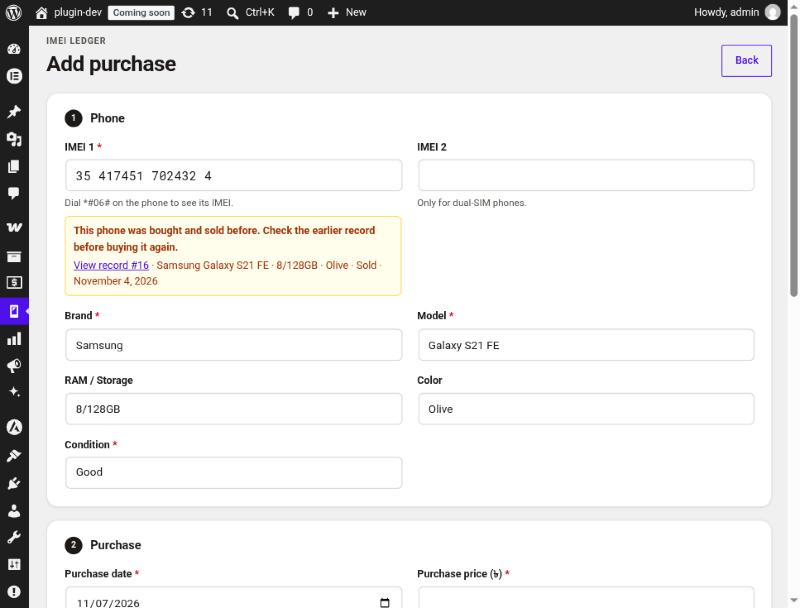
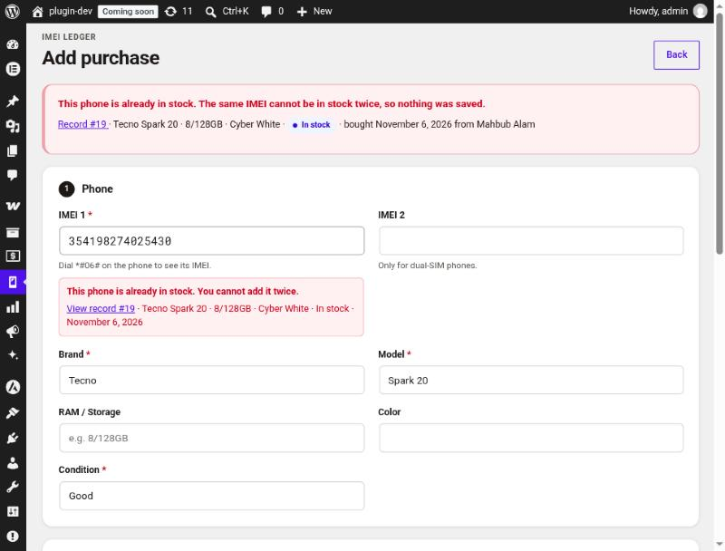
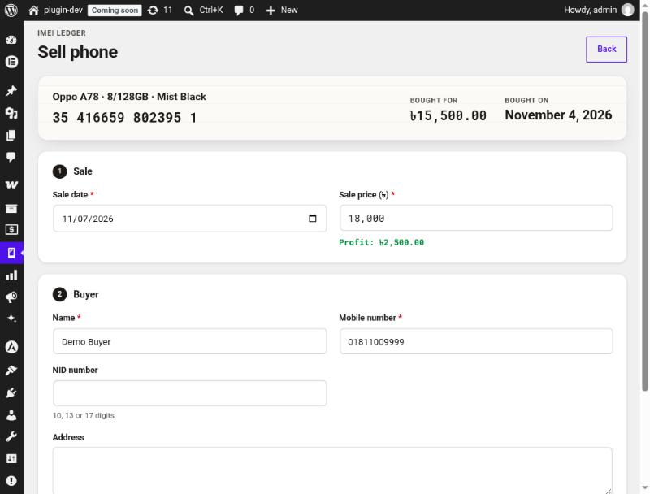
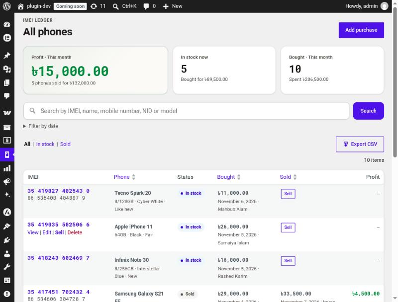
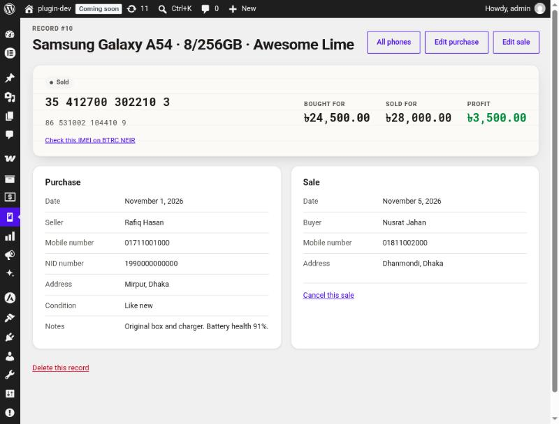
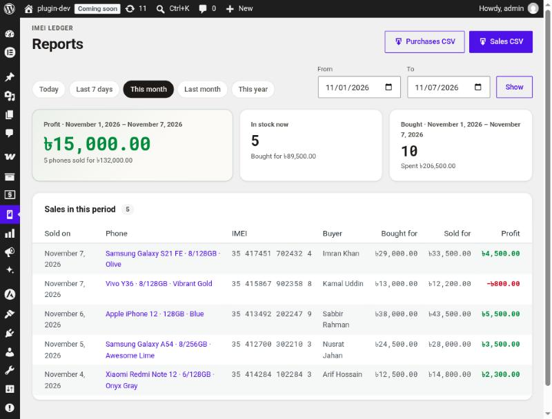

# Codereyes IMEI Ledger — User Guide

Codereyes IMEI Ledger keeps a record of every second-hand phone your shop buys and sells. Each phone is tracked by its IMEI, so you can look up its full history in seconds: who sold it to you, what you paid, who bought it, and what you earned.

This guide is for shop owners and staff. It covers everyday use, from the first purchase to the monthly report.

**Contents**

1. [Before you start](#1-before-you-start)
2. [Buying a phone](#2-buying-a-phone)
3. [When the IMEI is already in the ledger](#3-when-the-imei-is-already-in-the-ledger)
4. [Selling a phone](#4-selling-a-phone)
5. [Finding a phone](#5-finding-a-phone)
6. [Looking at one phone's record](#6-looking-at-one-phones-record)
7. [Fixing mistakes](#7-fixing-mistakes)
8. [Reports and CSV files](#8-reports-and-csv-files)
9. [Checking a phone before you buy it](#9-checking-a-phone-before-you-buy-it)
10. [Who can see the ledger](#10-who-can-see-the-ledger)
11. [Troubleshooting](#11-troubleshooting)
12. [Settings for developers](#12-settings-for-developers)

---

## 1. Before you start

**Requirements:** WordPress 6.4 or newer, PHP 7.4 or newer. WooCommerce is not needed.

**Install:**

1. In WordPress admin, go to **Plugins → Add New Plugin → Upload Plugin**.
2. Choose `codereyes-imei-ledger.zip` and click **Install Now**, then **Activate**.
3. A new **IMEI Ledger** menu appears in the admin sidebar, with three pages:

| Page | What it is for |
|---|---|
| **All Phones** | The full list, search, this month's totals, CSV export |
| **Add Purchase** | Record a phone you have just bought |
| **Reports** | Profit, sales and purchases for any date range |

Activation creates one database table for the ledger. Nothing is sent outside your website.

---

## 2. Buying a phone

Go to **IMEI Ledger → Add Purchase**. The form has four parts.



### Step 1 — Phone

| Field | Notes |
|---|---|
| **IMEI 1** (required) | Dial `*#06#` on the phone to see it. Spaces and dashes are fine, and so are Bengali digits (০-৯). |
| **IMEI 2** | Only for dual-SIM phones. It must be different from IMEI 1. |
| **Brand**, **Model** (required) | Start typing the brand to pick from common ones. |
| **RAM / Storage**, **Color** | For example `8/128GB`, `Black`. |
| **Condition** (required) | New, Like new, Good, Fair or Poor. |

As soon as you finish typing the IMEI, the box under it tells you one of four things:

| Message | Meaning |
|---|---|
| *Not a valid IMEI yet* (with a count like 12/15) | Keep typing. An IMEI has 15 digits. |
| *Not a valid IMEI yet* (at 15 digits) | One digit is wrong. The last digit of every IMEI is a check digit, so a typing mistake is caught here. Read it from `*#06#` again. |
| *New IMEI. No earlier records.* (green) | All good. |
| A yellow or red warning | The shop has seen this phone before. See [section 3](#3-when-the-imei-is-already-in-the-ledger). |

### Step 2 — Purchase

- **Purchase date**: today by default. It cannot be in the future.
- **Purchase price**: what you paid. You can type `15000`, `15,000`, `1,50,000`, `৳15,000` or `১৫,০০০`. Up to two decimal places.

### Step 3 — Seller

- **Name** and **Mobile number** are required.
- **NID number** is optional but strongly recommended. It must have 10, 13 or 17 digits.
- **Address** is optional.

If a phone later turns out to be stolen, this is the information the police will ask for.

### Step 4 — Notes

Anything worth remembering: box and charger, scratches, battery health, repairs.

Click **Save purchase**. The phone is now **In stock**, and its record opens.

---

## 3. When the IMEI is already in the ledger

The ledger never lets the same phone be in stock twice, but it does let you buy back a phone you sold earlier.

| Situation | What you see | What happens |
|---|---|---|
| The phone is **still in stock** | Red message: *This phone is already in stock* | Nothing is saved. Open the linked record to see the existing entry. |
| The phone was **bought and sold before** | Yellow message with the earlier record | Nothing is saved until you tick **"I have checked the earlier record and the seller"** and save again. A new record is created, so the old history is kept. |



Before ticking the box for a phone sold earlier, open the old record and compare: is the seller the person you sold it to? If not, ask how they got it.

---

## 4. Selling a phone

1. Find the phone in **All Phones** (see [section 5](#5-finding-a-phone)).
2. Click **Sell** in its row, or **Sell this phone** on its record.
3. Fill in:
   - **Sale date**: today by default. It cannot be before the purchase date or in the future.
   - **Sale price**: as you type, the profit (green) or loss (red) appears underneath.
   - **Buyer**: name and mobile number are required; NID and address are optional.
4. Click **Save sale**.



The phone is now **Sold**, and its profit shows in the list and reports.

---

## 5. Finding a phone

**IMEI Ledger → All Phones** shows every phone, newest first.



**Search box.** Type any of these and press **Search**:

- a full or partial IMEI (at least 4 digits), e.g. `702432`
- the seller's or buyer's name, e.g. `Rafiq`
- a mobile number or NID (at least 4 digits)
- a brand or model, e.g. `A54`

Bengali digits and names work too.

**Tabs.** **All**, **In stock** and **Sold** filter the list. They combine with the search.

**Filter by date.** Opens date fields. Choose whether to filter by the *purchase* or the *sale* date, pick a range, and click **Apply**. **Clear** removes all filters.

**Sorting.** Click the **Phone**, **Bought** or **Sold** column headings.

**Rows per page.** Use **Screen Options** at the top right (default 20).

**The cards at the top** show this month's profit and sales, how many phones are in stock now and what you paid for them, and how much you spent on purchases this month.

**Row actions.** Hover over a row to see **View**, **Edit**, **Sell** (in-stock phones) or **Cancel sale** (sold phones), and **Delete**.

---

## 6. Looking at one phone's record

Click an IMEI in the list to open its record.



- The top band shows the status, both IMEIs, the purchase and sale prices and the profit.
- **Purchase** and **Sale** list the seller's and buyer's details.
- **Other records with this IMEI** appears when the same phone has passed through the shop before.
- **Check this IMEI on BTRC NEIR** opens the government IMEI database in a new tab (see [section 9](#9-checking-a-phone-before-you-buy-it)).

---

## 7. Fixing mistakes

| Mistake | How to fix it |
|---|---|
| Wrong purchase details (price, seller, model…) | Open the record → **Edit purchase** → correct → **Update purchase**. |
| Wrong sale details | Open the record → **Edit sale** → correct → **Update sale**. |
| A sale was entered by mistake | Open the record → **Cancel this sale** → confirm. The phone goes back to **In stock** and the buyer details are cleared. |
| A record should not exist at all | Open the record → **Delete this record** → confirm. **This cannot be undone.** |

A sale cannot be cancelled if the same phone has since been bought again and is in stock, because two in-stock records for one IMEI are not allowed. Sell or delete the newer record first.

If you change a sold phone's purchase date, it cannot be later than its sale date.

---

## 8. Reports and CSV files

Go to **IMEI Ledger → Reports**.



1. Pick a quick range (**Today**, **Last 7 days**, **This month**, **Last month**, **This year**), or set **From** and **To** dates and click **Show**.
2. The cards show:
   - **Profit**: total of (sale price − purchase price) for phones *sold* in the range.
   - **In stock now**: phones in stock today and what you paid for them. This ignores the date range.
   - **Bought**: phones *bought* in the range and what you spent.
3. **Sales in this period** lists each sale with its profit. The latest 100 are shown on screen; the CSV has all of them.

### Downloading CSV files

| Button | Contains |
|---|---|
| **Sales CSV** (Reports) | Phones sold in the selected range |
| **Purchases CSV** (Reports) | Phones bought in the selected range, sold or not |
| **Export CSV** (All Phones) | Exactly what the list shows, with your current search, tab and date filter |

The files open directly in Excel or Google Sheets:

- Bengali names display correctly.
- IMEIs, mobile numbers and NIDs stay as text, so Excel does not turn an IMEI into `3.54E+14` or drop a mobile number's leading zero.
- Every row has a **Profit** column for sold phones.

Keep a monthly CSV as a backup of your ledger.

---

## 9. Checking a phone before you buy it

The ledger records what you are told. These checks help make sure it is true:

1. **Match the IMEI.** Dial `*#06#` and compare it with the IMEI on the box, the SIM tray (some models) and **Settings → About phone**. They should all agree.
2. **Check with BTRC.** In Bangladesh you can check whether an IMEI is registered on the NEIR system. Open any record and click **Check this IMEI on BTRC NEIR**, or visit neir.btrc.gov.bd.
3. **Check the ledger.** The live IMEI check shows whether your shop has handled this phone before (see [section 3](#3-when-the-imei-is-already-in-the-ledger)).
4. **Record the seller's NID.** Ask for the NID card and enter the number. Keep a photocopy if your shop policy allows.

---

## 10. Who can see the ledger

Seller and buyer details, including NID numbers, are personal data. Only users with the `manage_imei_ledger` capability can open the ledger:

- **Administrators** get it automatically.
- **Shop Managers** get it automatically when WooCommerce is installed, even if WooCommerce is installed after this plugin.

To give access to another role, such as shop staff, use a role-editor plugin and add the `manage_imei_ledger` capability. If you remove the capability from Shop Manager on purpose, the plugin will not add it back.

The ledger is stored only in your own WordPress database. The plugin does not send data anywhere.

---

## 11. Troubleshooting

| Problem | Why | What to do |
|---|---|---|
| *This is not a valid IMEI* | The IMEI is not 15 digits, or one digit is wrong (the check digit does not match). | Read the IMEI from `*#06#` again. Do not type the `/01` software version some phones show after it. |
| *Enter a price such as 15000 or 15000.50* | The price could not be read safely. `15000,50` and `1,5` are refused because the comma is ambiguous. | Use a dot for paisa (`15000.50`). Commas are only for grouping (`15,000`, `1,50,000`). |
| *An NID number has 10, 13 or 17 digits* | Bangladeshi NIDs have one of these lengths. | Check the number, or leave the field empty. |
| *Enter a phone number with 6 to 15 digits* | The mobile number is too short or too long. | Type it as `01XXXXXXXXX` or `+8801XXXXXXXXX`. |
| *Another save is in progress* | Two saves happened at the same moment (a double click, or two staff at once). | Wait a second and save again. |
| *This sale cannot be cancelled* | The same IMEI has since been bought again and is in stock. | See [section 7](#7-fixing-mistakes). |
| The **IMEI Ledger** menu is missing | Your user role does not have `manage_imei_ledger`. | Ask an administrator (see [section 10](#10-who-can-see-the-ledger)). |

---

## 12. Settings for developers

**Currency symbol.** The default is `৳`. To change it, add this to your theme's `functions.php` or a small plugin:

```php
add_filter( 'imei_ledger_currency_symbol', function () {
	return 'Tk ';
} );
```

**Removing all data.** Uninstalling the plugin keeps the ledger table, so a mistaken uninstall cannot wipe your shop's history. To delete everything, add this line to `wp-config.php`, then delete the plugin from the Plugins screen:

```php
define( 'IMEI_LEDGER_DELETE_DATA', true );
```

**Database.** Records live in the `{prefix}imei_ledger_records` table (`wp_imei_ledger_records` on most sites). Each row is one purchase and, once sold, its sale. A phone bought back after a sale gets a new row, so its full history is kept.
